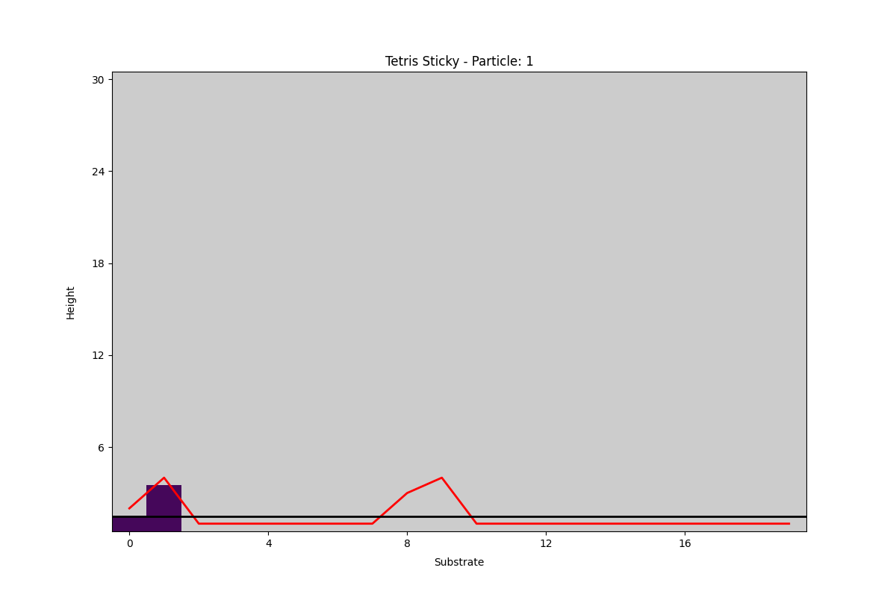
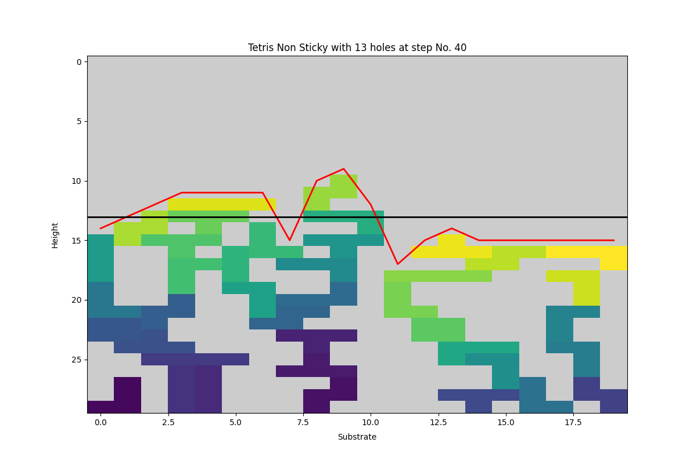

<div align="center">

# Simulations on Some Surface Growth Models

Monte Carlo simulation of ballistic deposition with Tetris pieces: sticky and
non-sticky tetrominoes fall onto a one-dimensional substrate and build a rough
growing interface. Python package `tetris-ballistic`.

[](https://github.com/chenle02/Simulations_on_Some_Surface_Growth_Models/actions/workflows/ci.yml)
[](https://pypi.org/project/tetris-ballistic/)
[](https://github.com/chenle02/Simulations_on_Some_Surface_Growth_Models/blob/main/.github/workflows/ci.yml)
[](https://github.com/chenle02/Simulations_on_Some_Surface_Growth_Models/blob/main/LICENSE)
[](https://simulations-on-some-surface-growth-models.readthedocs.io/main/)

[What it does](#what-it-does) · [Install](#install) · [Quick start](#quick-start) · [Documentation](https://simulations-on-some-surface-growth-models.readthedocs.io/main/) · [Examples](https://github.com/chenle02/Simulations_on_Some_Surface_Growth_Models/blob/main/examples.md) · [Cite](#how-to-cite)

</div>

## What it does

<table>
  <tr>
    <td align="center" width="50%">
      
      <br><sub>Sticky pieces: a piece may also stop at a side contact.</sub>
    </td>
    <td align="center" width="50%">
      
      <br><sub>Non-sticky pieces: each piece falls until it is supported from below.</sub>
    </td>
  </tr>
</table>

Pieces are dropped one at a time, each at a uniformly random horizontal
position where it fits, onto a strip of width `L` with hard side walls. They
do not rotate or slide after launch. The model has 20 piece types:

- `Piece-0` to `Piece-18`: the 19 fixed orientations of the seven tetrominoes
  O, I, L, J, T, S and Z;
- `Piece-19`: a single 1x1 cell, the classical ballistic-deposition baseline.

Each type carries two weights, `Piece-N: [nonsticky, sticky]`. All 40 weights
are normalized together into one sampling distribution, so any mixture of
sticky and non-sticky pieces can be set up in a short YAML file.

For each run the package records the substrate (the step at which each cell
was filled), and the mean interface height and the roughness (interface width)
at every step. It counts the holes left under the surface, renders a run as
PNG frames or an animated GIF, and includes tools for estimating KPZ growth
and roughness exponents from large ensembles of runs.

## Install

```bash
pip install tetris-ballistic
```

This installs the current **1.2.x** release from
[PyPI](https://pypi.org/project/tetris-ballistic/).

The `main` branch is the **2.x** line (version 2.1.0, unreleased). It adds a
numba kernel for 1x1-only runs, typed model and engine contracts, corrected
height and KPZ-analysis semantics, and a Slurm-array workflow; see the
[changelog](https://github.com/chenle02/Simulations_on_Some_Surface_Growth_Models/blob/main/CHANGELOG.md).
The 2.x line is not on PyPI. Install it from source:

```bash
git clone https://github.com/chenle02/Simulations_on_Some_Surface_Growth_Models.git
cd Simulations_on_Some_Surface_Growth_Models
pip install -e '.[hpc]'        # use '.[dev,hpc]' for pytest, ruff and benchmarks
```

## Quick start

```python
from tetris_ballistic import Tetris_Ballistic

# 20 columns, room for 150 rows, 200 pieces; all 19 Tetris pieces sticky.
tb = Tetris_Ballistic(width=20, height=150, steps=200, seed=42)
tb.Simulate()

print("final mean height:", tb.AvergeHeight[tb.FinalSteps - 1])
print("final roughness:  ", tb.Fluctuation[tb.FinalSteps - 1])
tb.Substrate2PNG(plot_title="Sticky Tetris, L = 20",
                 image_filename="sticky.png", envelop=True)
```

`Simulate()` prints a table of the target and sampled piece frequencies. On
`main` the last two lines are

```text
final mean height: 121.75
final roughness:   9.369498385719483
```

and `sticky.png` shows the deposit with its top envelope. The 1.2.x release
gives the same roughness but reports `AvergeHeight` as a row index counted from
the top of the grid (28.25 = 150 - 121.75); `main` reports the physical mean
height.

To run from a configuration file, pass `config_file="config.yaml"`, where the
file sets `width`, `height`, `steps`, `seed` and the 20 `Piece-N` weights.
[examples.md](https://github.com/chenle02/Simulations_on_Some_Surface_Growth_Models/blob/main/examples.md)
has configurations for sticky, non-sticky, mixed and 1x1 runs, with their
animations.

## Documentation

| If you want to | Start here |
|---|---|
| Learn the package API | [Read the Docs](https://simulations-on-some-surface-growth-models.readthedocs.io/main/) |
| Run example configurations | [examples.md](https://github.com/chenle02/Simulations_on_Some_Surface_Growth_Models/blob/main/examples.md) |
| Run large ensembles on a cluster | [Performance and HPC workflow](https://github.com/chenle02/Simulations_on_Some_Surface_Growth_Models/blob/main/docs/HPC-WORKFLOW.md) · [Benchmarks](https://github.com/chenle02/Simulations_on_Some_Surface_Growth_Models/blob/main/BENCHMARKS.md) |
| Understand the KPZ analysis rules | [KPZ analysis currentness contract](https://github.com/chenle02/Simulations_on_Some_Surface_Growth_Models/blob/main/docs/KPZ-ANALYSIS-CURRENTNESS.md) |
| Check the exact model semantics | [Legacy model map](https://github.com/chenle02/Simulations_on_Some_Surface_Growth_Models/blob/main/docs/LEGACY-MODEL-MAP.md) · [API and architecture specification](https://github.com/chenle02/Simulations_on_Some_Surface_Growth_Models/blob/main/docs/API-SPEC.md) |
| See what changed | [CHANGELOG.md](https://github.com/chenle02/Simulations_on_Some_Surface_Growth_Models/blob/main/CHANGELOG.md) |

Research notes from ongoing experiments, such as
[HANDOFF.md](https://github.com/chenle02/Simulations_on_Some_Surface_Growth_Models/blob/main/HANDOFF.md)
and the [experiments/](https://github.com/chenle02/Simulations_on_Some_Surface_Growth_Models/tree/main/experiments)
folder, are kept in the repository as working records.

## How to cite

If you use this software, please cite it and record the release (for example
`tetris-ballistic 1.2.8`) or the commit of `main` that you used:

> Le Chen, Mauricio Montes and Ian Ruau. *tetris-ballistic: Monte Carlo
> simulation of Tetris ballistic deposition and other surface growth models*.
> https://github.com/chenle02/Simulations_on_Some_Surface_Growth_Models

Metadata is in [CITATION.cff](https://github.com/chenle02/Simulations_on_Some_Surface_Growth_Models/blob/main/CITATION.cff);
GitHub's "Cite this repository" button reads it.

Background: A.-L. Barabási and H. E. Stanley, *Fractal Concepts in Surface
Growth*, Cambridge University Press, 1995; and Le Chen's
[graduate student seminar talk on surface growth models](https://github.com/chenle02/Graduate_Student_Seminars_by_Le_Chen/blob/main/2023-11-01/readme.md)
(November 2023).

## Credits

- **Le Chen** (Auburn University), main developer and maintainer.
- **Mauricio Montes** and **Ian Ruau** (Auburn University), contributors and
  package co-authors.
- **Shehzaib Irfan**, contributor (solid-on-solid simulation code).

The project began with a student's question in
[Math 7820, Applied Stochastic Processes I](http://webhome.auburn.edu/~lzc0090/teaching/2023_Fall_Math7820/),
Fall 2023, at Auburn University. It became the course's final exam project and
grew into a course project for Math 7830, Applied Stochastic Processes II,
in Spring 2024.

Contributions are welcome: fork the repository, work on a branch and open a
pull request against `main`. Please follow the
[code of conduct](https://github.com/chenle02/Simulations_on_Some_Surface_Growth_Models/blob/main/CODE_OF_CONDUCT.md).
For questions, contact Le Chen at le.chen@auburn.edu or chenle02@gmail.com.

## License

Released under the [MIT License](https://github.com/chenle02/Simulations_on_Some_Surface_Growth_Models/blob/main/LICENSE).
